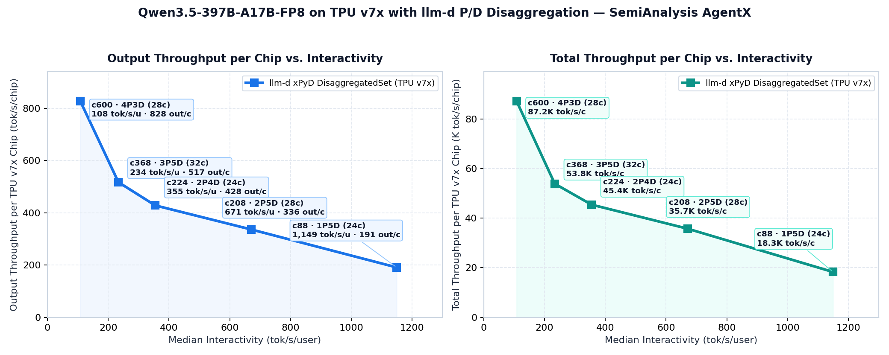

# Qwen3.5-397B on TPU 7x

This recipe deploys [`Qwen/Qwen3.5-397B-A17B-FP8`](https://huggingface.co/Qwen/Qwen3.5-397B-A17B-FP8) on Google Cloud TPU v7x (`tpu7x`) with Torch TPU vLLM and `llm-d` prefill/decode (`xPyD`) disaggregation, reproducing the [SemiAnalysis InferenceX AgentX Qwen-3.5 benchmark](https://inferencex.semianalysis.com/infx/inference/qwen-3-5) configuration as a Kubernetes [`DisaggregatedSet`](https://lws.sigs.k8s.io/docs/concepts/disaggregatedset/).
For a deep dive into every kernel, KV-cache, XLA, speculative decoding, and `llm-d` router optimization enabled across this deployment alongside the full benchmark analysis, see [**AGENTX.md**](AGENTX.md).
See also the [agentic workloads section of the Models overview](../../../docs/well-lit-paths/models/README.md#agentic-workloads), and the [GLM-5.2](../glm-5-2/README.md) and [NVIDIA Nemotron 3 Ultra](../nemotron-3-ultra/README.md) guides.

## Overview

Long-horizon coding agents generate deep multi-turn tool loops over repository-scale contexts (up to 262K tokens), making traffic heavily prefill-bound (>98% input tokens) with high prefix reuse across turns and subagents.

This guide packages all five Pareto-optimal operating points (`c88`, `c208`, `c224`, `c368`, and `c600`) from the SemiAnalysis AgentX TPU v7x `llm-d` recipe (`vllm-torchtpu` @ `5a1c82686`), combining:

- **xPyD Prefill/Decode Disaggregation (`DisaggregatedSet` + Raiden KV Transfer):** Prefill runs `PP=8 × TP=1` (`8,8,8,8,8,8,8,4` layer partition) with `PrefixAwareScheduler`, while decode runs either a low-latency `TP=8 + DCP=4` Qwen3.5 megakernel (`c88`–`c368`) or a multi-port `DP=4 × TP=2` fused-EP v3 layout (`c600`), joined over DCN by `TPURaidenConnector`.
- **550 GB Host-DRAM Tiered Prefix Cache per Prefill Node:** `TPUMultiConnector` pairs `TPURaidenConnector` (first, for load arbitration) with `TPURaidenOffloadingConnector` (`550 GB` host DRAM), sustaining `>92%` combined HBM + DRAM prefix cache hit rates across 262K-context multi-turn coding sessions.
- **Disaggregation- & Prefix-Affinity-Aware `llm-d` Routing:** Separate `prefill` and `decode` EPP scheduling profiles track a 2M-block offload-extended prefix index, gate prefill affinity against in-flight token load, apply decode spill/headroom and `x-dynamo-session-id` session affinity (`c600`), and screen rollouts via `disaggregatedset-rollout-screener`.
- **MTP Speculative Decoding & TPU/XLA Tuning:** Prefill runs MTP `k=1` and decode runs MTP `k=3` (configured with AgentX `synthetic_acceptance_length: 3.39` to match the benchmark harness), paired with SparseCore collective offload, static MoE expert placement, and hybrid Gated DeltaNet (`GDN`) + native FP8 Ragged Paged Attention (`RPA`) kernels (see [AGENTX.md](AGENTX.md)).

## Default Configuration

| Parameter | Value |
| --- | --- |
| Model | [`Qwen/Qwen3.5-397B-A17B-FP8`](https://huggingface.co/Qwen/Qwen3.5-397B-A17B-FP8) (`--language-model-only`, thinking + `qwen3_coder` tool calling enabled) |
| Default deployment | `DEPLOYMENT=c368` — `3P5D` (`3` prefill + `5` decode pods = `8` nodes / `32` TPU v7x chips) |
| Accelerator per pod | Google Cloud TPU v7x (`tpu7x-standard-4t`, `2x2x1` single-host slice: 4 chips, 8 TensorCores, 768 GB HBM) |
| Prefill engine | `PP=8 × TP=1` (`VLLM_PP_LAYER_PARTITION=8,8,8,8,8,8,8,4`), `--block-size=2176`, `--max-num-batched-tokens=8192`, MTP `k=1` |
| Decode engine | `tp8` (`c88`–`c368`): `TP=8, DCP=4, EP=8` Qwen3.5 + MTP megakernel · `dp4tp2` (`c600`): `DP=4 × TP=2, EP=8` multi-port external LB (`:8000..:8003`), `--block-size=640`, MTP `k=3` (`synthetic_acceptance_length: 3.39`) |
| Context length | `262,144` tokens (`fp8` weights, `fp8` `HND` KV cache, `--mamba-cache-mode=align`, unified GDN/attention block pool) |
| KV transfer & offload | `TPUMultiConnector`: `TPURaidenConnector` (`kv_port: 14579`) + `TPURaidenOffloadingConnector` (`550 GB` host DRAM per prefill pod) |
| Container images | `us-central1-docker.pkg.dev/ironwood-496417/torchtpu-vllm/torchtpu-vllm-prod:ix-tpu-pd-cand4-llmd-oct28` + `llm-d-router-disagg-sidecar` (`routing-sidecar/nightly`) |

### Operating Points (`DEPLOYMENT`)

Each `DEPLOYMENT` pairs a Kustomize overlay (`modelserver/tpu/vllm/deployments/${DEPLOYMENT}`) with its calibrated router configuration (`router/${DEPLOYMENT}.values.yaml`):

| `DEPLOYMENT` | Target Concurrency | Layout (`P` : `D`) | Nodes / Chips | Decode Profile | Decode Running Cap / Host | Median Interactivity | Output Tok/s/Chip | Total Tok/s/Chip |
| --- | ---: | --- | --- | --- | ---: | ---: | ---: | ---: |
| `c88` | 88 | `1P5D` | 6 / 24 | `TP=8, DCP=4, EP=8` megakernel (`tp` mode) | 1 | **1,149.4** tok/s/u | 190.9 | 18,267 |
| `c208` | 208 | `2P5D` | 7 / 28 | `TP=8, DCP=4, EP=8` megakernel (`tp` mode) | 3 | **671.1** tok/s/u | 335.9 | 35,702 |
| `c224` | 224 | `2P4D` | 6 / 24 | `TP=8, DCP=4, EP=8` megakernel (`ep` mode) | 8 | **354.6** tok/s/u | 428.3 | 45,409 |
| **`c368`** *(default)* | 368 | `3P5D` | 8 / 32 | `TP=8, DCP=4, EP=8` megakernel (`ep` mode) | 16 | **233.6** tok/s/u | 517.0 | 53,837 |
| `c600` | 600 | `4P3D` | 7 / 28 | `DP=4 × TP=2, EP=8` multi-port (`:8000..:8003`) | 112 (28 / rank) | **107.9** tok/s/u | **827.9** | **87,178** |

## Supported Accelerators and Model Servers

This guide includes configurations for the following accelerator and model server combinations:

<!-- guide:support start -->
| Accelerator | `ACCELERATOR_TYPE` | Served model | vLLM | Notes |
| --- | --- | --- | --- | --- |
| Google TPU v7x | `tpu` | `Qwen/Qwen3.5-397B-A17B-FP8` | 🟡 community | GKE only · Torch TPU vLLM (SemiAnalysis AgentX recipe) · 6 to 8 single-host `tpu7x` `2x2x1` slices (24 to 32 chips) by `DEPLOYMENT` (`c88`, `c208`, `c224`, `c368` default, `c600`) · xPyD `DisaggregatedSet` with PP=8 prefill + 550 GB host-DRAM KV offload, Raiden P/D transfer, and TP8+DCP4 megakernel or DP4×TP2 decode |

✅ validated: covered by a nightly E2E workflow · 🟡 community: maintained by the hardware vendor or community, not covered by nightly E2E · ❌ not supported: tracked in the linked issue · — no configuration.
<!-- guide:support end -->

## Prerequisites

- Have the [proper client tools installed on your local system](../../../helpers/client-setup/README.md) to use this guide.

- A GKE cluster with single-host TPU v7x (`tpu7x-standard-4t`, `cloud.google.com/gke-tpu-accelerator=tpu7x`, `cloud.google.com/gke-tpu-topology=2x2x1`) nodes — **6 to 8 nodes (24 to 32 chips)** depending on `DEPLOYMENT` (see [Google Cloud TPU infrastructure docs](../../../docs/infrastructure/providers/gke/tpu/README.md)):
  - **Boot disk ≥ 1 TB per node:** Model weights (~406 GB) and persistent XLA/Torch-TPU compile caches are stored on node-local `hostPath`s (`/var/cache/huggingface` and `/var/lib/tpu-cache`). The default 100 GB GKE boot disk will hit kubelet ephemeral-storage eviction mid-download.
  - **Host memory:** Each `tpu7x-standard-4t` node provides ~919 GiB allocatable RAM; engine containers request `850Gi` (`925Gi` limit) to hold the 550 GB pinned host-DRAM KV tier on prefill and weight/runtime buffers.
  - **Container image access:** Nodes must have Artifact Registry pull access to `us-central1-docker.pkg.dev/ironwood-496417/torchtpu-vllm/torchtpu-vllm-prod:ix-tpu-pd-cand4-llmd-oct28` (or mirror that digest into your cluster's Artifact Registry and update `images:` in [`base/kustomization.yaml`](modelserver/tpu/vllm/base/kustomization.yaml)).

- Deploy the [LeaderWorkerSet controller](https://lws.sigs.k8s.io/docs/installation/) `v0.11.1` or newer with `--set enableDisaggregatedSet=true` (installed in the step below).

- Create a [HuggingFace token](../../../helpers/hf-token.md) and export it as `HF_TOKEN` in your shell.

- (Optional) Install the [monitoring stack](../../../docs/operations/observability/setup.md) if you plan to enable Prometheus monitoring.

### Get the guide

Every command below runs from a local clone of the [llm-d repository](https://github.com/llm-d/llm-d): the manifests, Helm values, and Kustomize overlays it applies live next to this guide. Set the branch and clone the repo (if you already have a checkout, skip this and run the remaining commands from inside it):

<!-- guide:prerequisites.clone start -->
<!-- llm-d-cicd:skip start -->
```bash
export BRANCH=main
git clone https://github.com/llm-d/llm-d.git && cd llm-d && git checkout ${BRANCH}
```
<!-- llm-d-cicd:skip end -->
<!-- guide:prerequisites.clone end -->

### Configure the environment

**Set the guide-specific environment variables** (`DEPLOYMENT` selects both the router configuration and the `DisaggregatedSet` operating point):

<!-- guide:env.static start -->
```bash
export REPO_ROOT=$(realpath $(git rev-parse --show-toplevel))
export GUIDE_NAME=qwen3-5-397b
export NAMESPACE=llm-d-qwen3-5-397b
export MONITORING=false # options: false, true
export MONITORING_VALUES=
export ACCELERATOR_TYPE=tpu # options: tpu
export MODEL_SERVER=vllm # options: vllm
export DEPLOYMENT=c368 # options: c88, c208, c224, c368, c600
export MODEL=Qwen/Qwen3.5-397B-A17B-FP8 # the model every deployment serves
source ${REPO_ROOT}/guides/env.sh # defines GAIE_VERSION, LWS_VERSION, ROUTER_CHART_VERSION, router chart URLs, and CURL_TEST_IMAGE
```
<!-- guide:env.static end -->

**Install the Gateway API Inference Extension CRDs:**

<!-- guide:prerequisites.gaie start -->
```bash
# GAIE_URL is automatically calculated from GAIE_VERSION at ${REPO_ROOT}/guides/env.sh
kubectl apply -f https://github.com/kubernetes-sigs/gateway-api-inference-extension/${GAIE_URL}/v1-manifests.yaml
```
<!-- guide:prerequisites.gaie end -->

**Install the LeaderWorkerSet controller with the `DisaggregatedSet` API** (skip if your cluster already runs LWS `v0.11.1` or newer with `enableDisaggregatedSet=true`):

<!-- guide:prerequisites.lws start -->
<!-- llm-d-cicd:skip start -->
```bash
# helm upgrade never updates CRDs, so apply the chart's CRDs first (see LWS
# "Upgrade by Helm"); this upgrades them on clusters that run an older LWS.
helm pull oci://registry.k8s.io/lws/charts/lws --version=${LWS_VERSION} --untar
kubectl apply --server-side --force-conflicts -f lws/crds
helm upgrade --install lws oci://registry.k8s.io/lws/charts/lws \
  --version=${LWS_VERSION} \
  --namespace lws-system --create-namespace \
  --set enableDisaggregatedSet=true \
  --wait --timeout 300s
```
<!-- llm-d-cicd:skip end -->
<!-- guide:prerequisites.lws end -->

**Create a target namespace for the installation:**

<!-- guide:prerequisites.namespace start -->
```bash
kubectl create namespace ${NAMESPACE} --dry-run=client -o yaml | kubectl apply -f -
```
<!-- guide:prerequisites.namespace end -->

**Create the `llm-d-hf-token` secret** in your target namespace with the key [`HF_TOKEN`](../../../helpers/hf-token.md) matching a valid HuggingFace token to pull models:

<!-- guide:prerequisites.secrets start -->
<!-- llm-d-cicd:skip start -->
```bash
kubectl create secret generic llm-d-hf-token \
  --from-literal="HF_TOKEN=${HF_TOKEN}" \
  --namespace "${NAMESPACE}" \
  --dry-run=client -o yaml | kubectl apply -f -
```
<!-- llm-d-cicd:skip end -->
<!-- guide:prerequisites.secrets end -->

## Installation Instructions

### 1. Deploy the llm-d Router

**Prepare the paths to the `helm` values files** for the `llm-d` router. Each `router/${DEPLOYMENT}.values.yaml` configures `disaggregatedset-rollout-screener`, P/D scheduling profiles, the 2M-block offload-aware prefix index, calibrated `peakPrefillThroughput` (`62000` on `c88`–`c368`, `27000` on `c600`), and decode port discovery (`:8000` on `c88`–`c368`; `:8000..:8003` with `x-dynamo-session-id` session affinity on `c600`):

<!-- guide:deploy.router_values start -->
```bash
export ROUTER_BASE_VALUES="${REPO_ROOT}/guides/recipes/router/base.values.yaml"
export ROUTER_VALUES="${REPO_ROOT}/guides/models/${GUIDE_NAME}/router/${DEPLOYMENT}.values.yaml"
```
<!-- guide:deploy.router_values end -->

**(Optional) Enable Prometheus monitoring on the `llm-d` router** by defining the `helm` values file (requires installing the monitoring stack mentioned in [Prerequisites](#prerequisites)):

<!-- guide:deploy.monitoring_values start -->
```bash
# only when MONITORING=true:
export MONITORING_VALUES="-f ${REPO_ROOT}/guides/recipes/router/features/monitoring.values.yaml"
```
<!-- guide:deploy.monitoring_values end -->

> [!NOTE]
> **`peakPrefillThroughput` calibration:** The router values ship with `peakPrefillThroughput: 62000` (`c88`–`c368`) and `27000` (`c600`), tuned on `tpu7x` `PP=8` prefill engines under the 262K AgentX coding workload. To re-calibrate for custom chunk sizes or workloads, see the [router calibration tool](../../recipes/router/calibration/README.md).

**Deploy the router** in [Standalone Mode](../../../docs/architecture/router/proxy.md), with an Envoy sidecar in front of the EPP. Keep the release name `${GUIDE_NAME}`: the verification steps look up the `${GUIDE_NAME}-epp` Service by that name. To front the router with a Kubernetes Gateway instead, see Gateway Mode in the [Optimized Baseline](../../optimized-baseline/README.md#1-deploy-the-llm-d-router).

<!-- guide:deploy.standalone start -->
```bash
helm install ${GUIDE_NAME} \
  ${ROUTER_STANDALONE_CHART} \
  -f ${ROUTER_BASE_VALUES} \
  ${MONITORING_VALUES} \
  -f ${ROUTER_VALUES} \
  -n ${NAMESPACE} --version ${ROUTER_CHART_VERSION}
```
<!-- guide:deploy.standalone end -->

### 2. Deploy the Model Server

**Apply the Kustomize overlay** for your chosen `DEPLOYMENT`:

<!-- guide:deploy.modelserver start -->
```bash
kubectl apply -n ${NAMESPACE} \
  -k ${REPO_ROOT}/guides/models/${GUIDE_NAME}/modelserver/${ACCELERATOR_TYPE}/${MODEL_SERVER}/deployments/${DEPLOYMENT}
```
<!-- guide:deploy.modelserver end -->

Wait for the `DisaggregatedSet` to become available (first boot on a cold node downloads the ~406 GB FP8 checkpoint into `/var/cache/huggingface` and populates the persistent XLA/Torch-TPU compile cache under `/var/lib/tpu-cache`; subsequent restarts reuse both caches via `tpu-compile-sitecustomize`):

```bash
kubectl get pods -n ${NAMESPACE} -l llm-d.ai/guide=qwen3-5-397b -w
kubectl wait --for=condition=Available disaggregatedset/pd-disagg-tpu-qwen35 -n ${NAMESPACE} --timeout=10800s
```

**(Optional) Deploy the monitoring resources for model servers** (requires installing the monitoring stack mentioned in [Prerequisites](#prerequisites); automatically applies the 4-port decode `PodMonitor` when `DEPLOYMENT=c600`):

<!-- guide:deploy.monitoring start -->
```bash
# only when MONITORING=true:
if [[ "${DEPLOYMENT}" == "c600" ]]; then
  kubectl apply -n ${NAMESPACE} -k ${REPO_ROOT}/guides/models/${GUIDE_NAME}/monitoring/multi-port
else
  kubectl apply -n ${NAMESPACE} -k ${REPO_ROOT}/guides/models/${GUIDE_NAME}/monitoring
fi
```
<!-- guide:deploy.monitoring end -->

## Verification

### 1. Get the IP of the Proxy

<!-- guide:verify.endpoint.standalone start -->
```bash
export IP=$(kubectl get service ${GUIDE_NAME}-epp -n ${NAMESPACE} -o jsonpath='{.spec.clusterIP}')
```
<!-- guide:verify.endpoint.standalone end -->

### 2. Send Test Requests

**Send a completion request from a temporary pod inside the cluster:**

<!-- guide:verify.tests.request start -->
```bash
kubectl run curl-test --rm -i --restart=Never \
  --image=${CURL_TEST_IMAGE} \
  --namespace="${NAMESPACE}" \
  --env="IP=${IP}" \
  --env="MODEL=${MODEL}" \
  -- /bin/sh -c 'curl -sS -X POST "http://${IP}/v1/completions" -H "Content-Type: application/json" -d "{\"model\": \"${MODEL}\", \"prompt\": \"Explain how a simple agent loop works in 3 sentences.\"}"'
```
<!-- guide:verify.tests.request end -->

**Check that the router reaches a model server that serves `MODEL`:** the response must name the model and carry generated tokens:

<!-- guide:verify.tests.served_model start -->
```bash
# The router must reach a model server that serves MODEL and returns tokens
kubectl run serve-check --rm -i --restart=Never \
  --image=${CURL_TEST_IMAGE} \
  --namespace="${NAMESPACE}" \
  --env="IP=${IP}" \
  --env="MODEL=${MODEL}" \
  -- /bin/sh -c 'R=$(curl -sS -X POST "http://${IP}/v1/completions" -H "Content-Type: application/json" -d "{\"model\": \"${MODEL}\", \"prompt\": \"Say hello.\", \"max_tokens\": 16}")
    echo "${R}" | grep -q "\"model\":\"${MODEL}\"" && echo "${R}" | grep -q "\"choices\"" \
      && echo "OK: ${MODEL} served through the router" \
      || { echo "FAIL: ${R}"; exit 1; }'
```
<!-- guide:verify.tests.served_model end -->

## Benchmarking

### 1. SemiAnalysis AgentX Coding Trace Replay (`aiperf`)

The published results below were measured with [`aiperf`](https://github.com/ai-dynamo/aiperf) replaying the 256K multi-turn coding and subagent trace dataset ([`semianalysisai/cc-traces-weka-062126-256k`](https://huggingface.co/datasets/semianalysisai/cc-traces-weka-062126-256k)) for 3,600 seconds per concurrency point against the `llm-d` router:

```bash
export AIPERF_HTTP_X_DYNAMO_SESSION_ID_FROM_CORRELATION_ID=true
export AIPERF_USE_DYNAMO_CONV_AWARE_ROUTING=0

aiperf profile \
  --scenario 'inferencex-agentx-mvp' \
  --url "http://${GUIDE_NAME}-epp.${NAMESPACE}.svc.cluster.local:80/v1" \
  --model 'Qwen/Qwen3.5-397B-A17B-FP8' \
  --endpoint-type 'chat' \
  --streaming \
  --use-server-token-count \
  --public-dataset 'semianalysis_cc_traces_weka_with_subagents' \
  --concurrency <88|208|224|368|600> \
  --random-seed 42 \
  --benchmark-duration 3600 \
  --no-gpu-telemetry \
  --output-artifact-dir ./agentx-results \
  --ui 'simple'
```

> [!IMPORTANT]
> **Synthetic MTP Token Acceptance (AgentX Benchmark Mode):**
> To reproduce the exact [SemiAnalysis InferenceX AgentX](https://inferencex.semianalysis.com/infx/inference/qwen-3-5) throughput and latency numbers, all deployments enable `SYNTHETIC_ACCEPTANCE_LENGTH=3.39` and `--speculative-config='{"method":"mtp","num_speculative_tokens":3,"rejection_sample_method":"synthetic","synthetic_acceptance_length":3.39}'` on decode.
> For accuracy evaluations (such as GSM8K) or production text generation, set `SYNTHETIC_ACCEPTANCE_LENGTH=0` and `--speculative-config='{"method":"mtp","num_speculative_tokens":3}'` so draft tokens are verified against target logits (see [AGENTX.md](AGENTX.md#6-multi-token-prediction-mtp--synthetic-token-acceptance)).

### 2. Synthetic Agentic Replay (`inference-perf`)

For a self-contained Kubernetes Job benchmark without external trace datasets, [`inference-perf.yaml`](inference-perf.yaml) replays a synthetic multi-turn agentic code-generation distribution against `http://qwen3-5-397b-epp`:

```bash
export CONCURRENCY_LEVEL=88
export NUM_REQUESTS=$((20 * CONCURRENCY_LEVEL))
export SEED=$((7 + CONCURRENCY_LEVEL))

kubectl delete job inference-perf -n ${NAMESPACE} --ignore-not-found
envsubst < ${REPO_ROOT}/guides/models/${GUIDE_NAME}/inference-perf.yaml | kubectl apply -n ${NAMESPACE} -f -
kubectl logs -n ${NAMESPACE} job/inference-perf -f
```

## Benchmark Results

Live interactive results are published on the [**SemiAnalysis InferenceX Qwen-3.5 Dashboard**](https://inferencex.semianalysis.com/infx/inference/qwen-3-5) (`Qwen/Qwen3.5-397B-A17B-FP8`, 262,144 max context, ~90K–100K mean input tokens/request, ~926–951 mean output tokens/request, 1-hour sustained `aiperf` AgentX multi-turn coding trace replay on Google Cloud TPU v7x `2x2x1` slices).
Per-chip metrics divide by total physical TPU v7x chips across **both** prefill and decode pools (`4` chips per `2x2x1` host). See [**AGENTX.md**](AGENTX.md) for full optimization details across every operating point.



| `DEPLOYMENT` | Layout (Chips) | Conc. | Total Tok/s | Total Tok/s/Chip | Output Tok/s | Output Tok/s/Chip | Median Interactivity (Tok/s/User) | Median / P90 ITL (ms) | Median / P90 TTFT (s) | Prefix Cache Hit (HBM + DRAM) | GSM8K (`em_strict`) |
| --- | --- | ---: | ---: | ---: | ---: | ---: | ---: | ---: | ---: | ---: | ---: |
| `c88` | `1P5D` (24) | 88 | 438,410 | 18,267 | 4,582 | 190.9 | **1,149.4** | **0.87** / 0.94 | 2.53 / 8.58 | 93.3% (87.0% + 6.3%) | 97.57% |
| `c208` | `2P5D` (28) | 208 | 999,669 | 35,702 | 9,407 | 335.9 | **671.1** | 1.49 / 1.60 | 5.04 / 11.95 | 92.9% (86.5% + 6.4%) | 97.27% |
| `c224` | `2P4D` (24) | 224 | 1,089,805 | 45,409 | 10,278 | 428.3 | **354.6** | 2.82 / 3.04 | 3.29 / 8.58 | 93.4% (85.9% + 7.5%) | 97.65% |
| **`c368`** | `3P5D` (32) | 368 | 1,722,770 | 53,837 | 16,544 | 517.0 | **233.6** | 4.28 / 4.56 | 2.57 / 6.63 | 92.6% (84.7% + 7.9%) | 97.57% |
| `c600` | `4P3D` (28) | 600 | **2,440,978** | **87,178** | **23,180** | **827.9** | 107.9 | 9.27 / 9.81 | **1.81** / **5.36** | 92.1% (80.9% + 11.2%) | **97.80%** |

## Cleanup

To remove the deployed components:

<!-- guide:cleanup.modelserver start -->
```bash
kubectl delete -n ${NAMESPACE} -k ${REPO_ROOT}/guides/models/${GUIDE_NAME}/modelserver/${ACCELERATOR_TYPE}/${MODEL_SERVER}/deployments/${DEPLOYMENT}
```
<!-- guide:cleanup.modelserver end -->

<!-- guide:cleanup.rest start -->
```bash
helm uninstall ${GUIDE_NAME} -n ${NAMESPACE}

kubectl delete -n ${NAMESPACE} -k ${REPO_ROOT}/guides/models/${GUIDE_NAME}/monitoring/multi-port --ignore-not-found=true
kubectl delete -n ${NAMESPACE} -k ${REPO_ROOT}/guides/models/${GUIDE_NAME}/monitoring --ignore-not-found=true
```
<!-- llm-d-cicd:skip start -->
```bash
kubectl delete namespace ${NAMESPACE}
```
<!-- llm-d-cicd:skip end -->
<!-- guide:cleanup.rest end -->
