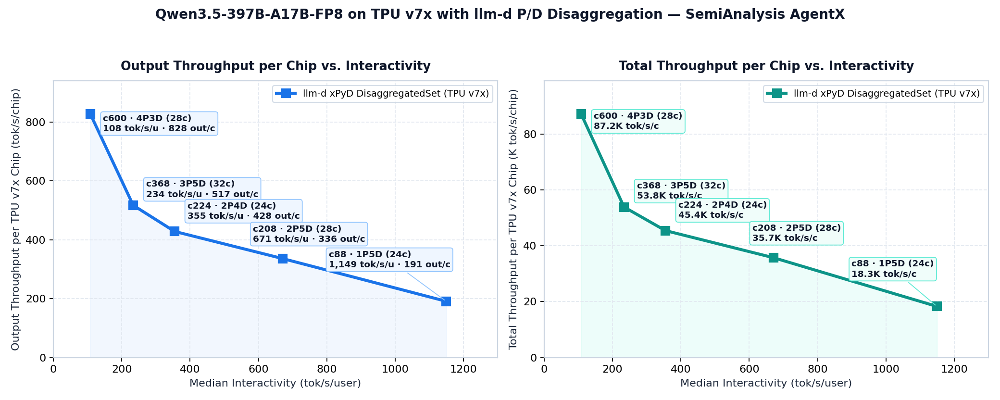

# Qwen3.5-397B on TPU v7x with `llm-d` — SemiAnalysis AgentX Submission Recipe

This directory contains the reproducible Kubernetes [`DisaggregatedSet`](https://lws.sigs.k8s.io/docs/concepts/disaggregatedset/) and `llm-d-router` deployment recipe used for the **SemiAnalysis InferenceX AgentX** benchmark submission of [`Qwen/Qwen3.5-397B-A17B-FP8`](https://huggingface.co/Qwen/Qwen3.5-397B-A17B-FP8) on Google Cloud TPU v7x (`tpu7x`) with Torch TPU vLLM (`vllm-torchtpu`).

- **Live benchmark dashboard:** [**SemiAnalysis InferenceX — Qwen-3.5**](https://inferencex.semianalysis.com/infx/inference/qwen-3-5)
- **Standard 2-node production guide:** [../../../README.md](../../../README.md) (uses the public `vllm/vllm-torchtpu` release image and standard target-logit rejection sampling on 8 TPU v7x chips)
- **Model server manifests:** [`modelserver/`](modelserver/base/disaggregatedset.yaml) (`base/`, `components/`, and per-point overlays `deployments/{c88,c208,c224,c368,c600}`)
- **Router Helm values:** [`router/c88.values.yaml`](router/c88.values.yaml) through [`router/c600.values.yaml`](router/c600.values.yaml)

---

## SemiAnalysis InferenceX AgentX Results on TPU v7x

All five Pareto-optimal operating points below were measured on the [**SemiAnalysis InferenceX Qwen-3.5 AgentX suite**](https://inferencex.semianalysis.com/infx/inference/qwen-3-5) using [`aiperf`](https://github.com/ai-dynamo/aiperf) (`--scenario inferencex-agentx-mvp`) replaying the 256K multi-turn coding and subagent trace corpus ([`semianalysisai/cc-traces-weka-062126-256k`](https://huggingface.co/datasets/semianalysisai/cc-traces-weka-062126-256k)) for 1 hour (`3,600 s`) per point against `llm-d` + `vllm-torchtpu`:

- **Workload profile:** `262,144` max context length, `90,011`–`99,623` mean input tokens per request (`>98.9%` of total tokens are prompt tokens), `926`–`951` mean generated output tokens per request, thinking enabled (`--default-chat-template-kwargs='{"enable_thinking":true}'`), and `qwen3_coder` tool-call + `qwen3` reasoning parsers active.
- **Hardware accounting:** Each prefill and decode pod occupies one single-host `tpu7x-standard-4t` slice (`2x2x1` = **4 physical TPU v7x chips** / **8 TensorCore devices**, 768 GB HBM, ~919 GiB allocatable host DRAM). Per-chip metrics divide aggregate cluster throughput by total physical TPU v7x chips across **both** prefill and decode pools (`24` to `32` chips).
- **Serving image:** `us-central1-docker.pkg.dev/ironwood-496417/torchtpu-vllm/torchtpu-vllm-prod:ix-tpu-pd-cand4-llmd-oct28` (`vllm-torchtpu` `infx-qwen35-agentx-disagg-candidate4` @ `5a1c82686`).



| `POINT` | Layout (`P` : `D`) | Chips (`P` + `D`) | Conc. | Completed Requests (1h) | Total Tok/s | Total Tok/s/Chip | Output Tok/s | Output Tok/s/Chip | Median Interactivity (Tok/s/User) | Median / P90 ITL (ms) | Median / P90 TTFT (s) | Prefix Cache Hit (HBM + DRAM) | GSM8K (`em_strict`) |
| --- | --- | --- | ---: | ---: | ---: | ---: | ---: | ---: | ---: | ---: | ---: | ---: | ---: |
| [`c88`](modelserver/deployments/c88/kustomization.yaml) | `1P5D` | `4 + 20 = 24` | 88 | 17,371 | 438,410 | 18,267 | 4,582 | 190.9 | **1,149.4** | **0.87** / 0.94 | 2.53 / 8.58 | 93.3% (87.0% + 6.3%) | 97.57% |
| [`c208`](modelserver/deployments/c208/kustomization.yaml) | `2P5D` | `8 + 20 = 28` | 208 | 35,940 | 999,669 | 35,702 | 9,407 | 335.9 | **671.1** | 1.49 / 1.60 | 5.04 / 11.95 | 92.9% (86.5% + 6.4%) | 97.27% |
| [`c224`](modelserver/deployments/c224/kustomization.yaml) | `2P4D` | `8 + 16 = 24` | 224 | 39,681 | 1,089,805 | 45,409 | 10,278 | 428.3 | **354.6** | 2.82 / 3.04 | 3.29 / 8.58 | 93.4% (85.9% + 7.5%) | 97.65% |
| [**`c368`**](modelserver/deployments/c368/kustomization.yaml) *(default)* | `3P5D` | `12 + 20 = 32` | 368 | 64,104 | 1,722,770 | 53,837 | 16,544 | 517.0 | **233.6** | 4.28 / 4.56 | 2.57 / 6.63 | 92.6% (84.7% + 7.9%) | 97.57% |
| [`c600`](modelserver/deployments/c600/kustomization.yaml) | `4P3D` | `16 + 12 = 28` | 600 | 90,844 | **2,440,978** | **87,178** | **23,180** | **827.9** | 107.9 | 9.27 / 9.81 | **1.81** / **5.36** | 92.1% (80.9% + 11.2%) | **97.80%** |

---

## Choosing an Operating Point (`POINT`)

A single environment variable (`POINT`, defaulting to `c368`) selects both the calibrated `llm-d-router` values file (`router/${POINT}.values.yaml`) and the `DisaggregatedSet` overlay (`modelserver/deployments/${POINT}`):

| Operator Goal | `POINT` | Layout (Nodes / Chips) | Decode Profile & Running Cap | Median Interactivity | Output / Total Tok/s/Chip |
| --- | --- | --- | --- | ---: | ---: |
| **Ultra-low latency** (`<1 ms` ITL) | `c88` | `1P5D` (6 nodes / 24 chips) | `tp8` megakernel (`tp` mode, `cap=1`) | **1,149.4 tok/s/u** (`0.87 ms`) | `190.9` / `18,267` |
| **Low latency** (`~1.5 ms` ITL) | `c208` | `2P5D` (7 nodes / 28 chips) | `tp8` megakernel (`tp` mode, `cap=3`) | **671.1 tok/s/u** (`1.49 ms`) | `335.9` / `35,702` |
| **Balanced efficiency on 24 chips** | `c224` | `2P4D` (6 nodes / 24 chips) | `tp8` megakernel (`ep` mode, `cap=8`) | **354.6 tok/s/u** (`2.82 ms`) | `428.3` / `45,409` |
| **Default high-interactivity throughput** | **`c368`** | `3P5D` (8 nodes / 32 chips) | `tp8` megakernel (`ep` mode, `cap=16`) | **233.6 tok/s/u** (`4.28 ms`) | `517.0` / `53,837` |
| **Maximum throughput per chip** | `c600` | `4P3D` (7 nodes / 28 chips) | `dp4tp2` 4-port (`:8000..:8003`, `cap=112`) | `107.9 tok/s/u` (`9.27 ms`) | **`827.9`** / **`87,178`** |

---

## Quickstart Deployment

### Prerequisites

1. **GKE Cluster with TPU v7x (`tpu7x`) Single-Host Node Pools:** `6` to `8` `tpu7x-standard-4t` nodes (`cloud.google.com/gke-tpu-accelerator: tpu7x`, `cloud.google.com/gke-tpu-topology: 2x2x1`, ≥925 GiB host DRAM per node for the 550 GB pinned KV offload pool).
2. **Client Tools & Cluster CRDs:** `kubectl`, `kustomize`, `helm`, Gateway API Inference Extension (`GAIE`) CRDs, and LeaderWorkerSet (`LWS`) installed with `enableDisaggregatedSet=true` (see [Prerequisites in `../../../README.md`](../../../README.md#prerequisites)).
3. **Image Access:** Pull access from GKE nodes to `us-central1-docker.pkg.dev/ironwood-496417/torchtpu-vllm/torchtpu-vllm-prod:ix-tpu-pd-cand4-llmd-oct28`.

### 1. Configure Environment & Namespace

```bash
export REPO_ROOT=$(realpath $(git rev-parse --show-toplevel))
source "${REPO_ROOT}/guides/env.sh"

export RELEASE_NAME=qwen3-5-397b-agentx
export NAMESPACE=llm-d-qwen3-5-397b-agentx
export POINT=c368   # c88 | c208 | c224 | c368 | c600
export RECIPE_DIR="${REPO_ROOT}/guides/models/qwen3-5-397b/benchmarks/agentx/tpu-vllm"

kubectl create namespace "${NAMESPACE}" --dry-run=client -o yaml | kubectl apply -f -
kubectl create secret generic llm-d-hf-token \
  --from-literal="HF_TOKEN=${HF_TOKEN}" \
  --namespace "${NAMESPACE}" \
  --dry-run=client -o yaml | kubectl apply -f -
```

### 2. Deploy the `llm-d` Router & `DisaggregatedSet`

```bash
helm upgrade --install "${RELEASE_NAME}" \
  "${ROUTER_STANDALONE_CHART}" \
  -f "${REPO_ROOT}/guides/recipes/router/base.values.yaml" \
  -f "${RECIPE_DIR}/router/${POINT}.values.yaml" \
  -n "${NAMESPACE}" --version "${ROUTER_CHART_VERSION}"

kubectl apply -n "${NAMESPACE}" -k "${RECIPE_DIR}/modelserver/deployments/${POINT}"
```

Optional — apply scoped Prometheus `PodMonitor`s (`monitoring/multi-port` scrapes all four DP rank ports `:8200..:8203` on `c600`):

```bash
if [[ "${POINT}" == "c600" ]]; then
  kubectl apply -n "${NAMESPACE}" -k "${RECIPE_DIR}/monitoring/multi-port"
else
  kubectl apply -n "${NAMESPACE}" -k "${RECIPE_DIR}/monitoring"
fi
```

### 3. Verify Readiness & Send a Test Request

First-boot XLA compilation populates `/var/lib/tpu-cache` on each host (`startupProbe` allows up to 3 hours; subsequent restarts hit the persistent cache via `tpu-compile-sitecustomize`):

```bash
kubectl get pods -l llm-d.ai/guide=qwen3-5-397b-agentx -n "${NAMESPACE}" -w
```

Once all prefill and decode pods report `Ready`, test end-to-end routing through the EPP service:

```bash
export IP=$(kubectl get service "${RELEASE_NAME}-epp" -n "${NAMESPACE}" -o jsonpath='{.spec.clusterIP}')

kubectl run curl-test --rm -i --restart=Never \
  --image="${CURL_TEST_IMAGE}" \
  --namespace="${NAMESPACE}" \
  --env="IP=${IP}" \
  -- /bin/sh -c 'curl -sS -X POST "http://${IP}/v1/chat/completions" \
    -H "Content-Type: application/json" \
    -d "{\"model\":\"Qwen/Qwen3.5-397B-A17B-FP8\",\"messages\":[{\"role\":\"user\",\"content\":\"Explain prefill/decode disaggregation in two sentences.\"}],\"max_tokens\":128}"'
```

### Switching Operating Points In Place

To move along the Pareto curve (for example, from `c368` to `c224` or `c600`), update `POINT` and re-run the same two commands (`disaggregatedset-rollout-screener` prevents cross-revision P/D pairing during rollout):

```bash
export POINT=c600
helm upgrade --install "${RELEASE_NAME}" "${ROUTER_STANDALONE_CHART}" \
  -f "${REPO_ROOT}/guides/recipes/router/base.values.yaml" \
  -f "${RECIPE_DIR}/router/${POINT}.values.yaml" \
  -n "${NAMESPACE}" --version "${ROUTER_CHART_VERSION}"
kubectl apply -n "${NAMESPACE}" -k "${RECIPE_DIR}/modelserver/deployments/${POINT}"
```

---

## Replaying the SemiAnalysis AgentX Benchmark (`aiperf`)

Run [`aiperf`](https://github.com/ai-dynamo/aiperf) inside the cluster against `${RELEASE_NAME}-epp` with the concurrency matching `POINT` (`88`, `208`, `224`, `368`, or `600`):

```bash
export AIPERF_HTTP_X_DYNAMO_SESSION_ID_FROM_CORRELATION_ID=true
export AIPERF_USE_DYNAMO_CONV_AWARE_ROUTING=0

aiperf profile \
  --scenario 'inferencex-agentx-mvp' \
  --url "http://${RELEASE_NAME}-epp.${NAMESPACE}.svc.cluster.local:80/v1" \
  --model 'Qwen/Qwen3.5-397B-A17B-FP8' \
  --endpoint-type 'chat' \
  --streaming \
  --use-server-token-count \
  --public-dataset 'semianalysis_cc_traces_weka_with_subagents' \
  --concurrency "${POINT#c}" \
  --random-seed 42 \
  --benchmark-duration 3600 \
  --no-gpu-telemetry \
  --output-artifact-dir "./agentx-results-${POINT}" \
  --ui 'simple'
```

> [!IMPORTANT]
> **Synthetic MTP Token Acceptance vs. Real Rejection Sampling (`components/real-sampling`):**
> By default, all five overlays enable the SemiAnalysis AgentX benchmark methodology (`SYNTHETIC_ACCEPTANCE_LENGTH=3.39` and `DECODE_SPEC_CONFIG='{"method":"mtp","num_speculative_tokens":3,"rejection_sample_method":"synthetic","synthetic_acceptance_length":3.39}'`), committing drafted tokens at Qwen3.5's calibrated 3.39-token mean acceptance length on the AgentX trace corpus.
>
> For accuracy evaluations (such as GSM8K) or interactive text generation, uncomment `- ../../components/real-sampling` in `modelserver/deployments/${POINT}/kustomization.yaml` before running `kubectl apply -k` to verify draft tokens against target logits (`SYNTHETIC_ACCEPTANCE_LENGTH=0`).

---

## Across-the-Board Optimizations Enabled

Reproducing the Pareto frontier above requires coordinated optimizations across seven layers of the serving stack: orchestration, `llm-d` routing, prefill parallelism & tiered KV offloading, decode megakernel / multi-port DP execution, hybrid Gated DeltaNet + FP8 attention kernels, MTP speculative decoding, and XLA / SparseCore compiler tuning.

### 1. Asymmetric `xPyD` Disaggregation via `DisaggregatedSet`

Agentic coding turns append short tool outputs (~1K–2K new tokens) onto massive ~95K-token conversation prefixes and then generate ~930 reasoning + tool-call tokens while other sessions pause in tool execution. Colocating prefill and decode on the same TPU slice either starves decode interactivity during chunked prefill bursts or wastes HBM bandwidth at small prefill chunks.

- **Single `DisaggregatedSet` (`pd-disagg-tpu-qwen35`):** Orchestrates independent `prefill` and `decode` `LeaderWorkerSet` pools (`size: 1` single-host `2x2x1` slice per pod) with `maxSurge: 0, maxUnavailable: 1` rollout semantics for fixed-size TPU reservations and graceful drain (`--shutdown-timeout=45` + 15 s `preStop` sleep).
- **Asymmetric parallelisms & block sizes:**
  - **Prefill (`PP=8 × TP=1`):** Pipelines the 60 transformer layers across the 8 TensorCores of one host (`VLLM_PP_LAYER_PARTITION=8,8,8,8,8,8,8,4`, placing 4 layers + LM head + MTP draft head on the final stage) with `--block-size=2176`, `--max-num-batched-tokens=8192`, and `--long-prefill-token-threshold=262144` so each prefill worker streams large prompt chunks with zero tensor-parallel all-reduce overhead.
  - **Decode (`tp8` vs. `dp4tp2`, `--block-size=640`):** Uses smaller 640-token KV blocks and `--max-num-batched-tokens=2048` with `--async-scheduling` to maximize concurrent 262K-context slots in HBM and overlap host scheduling with device execution.

### 2. `llm-d` Router (`EPP`) & Disaggregation Sidecar Optimizations

Each operating point pairs a calibrated [`EndpointPickerConfig`](router/c368.values.yaml) with the `llm-d-router-disagg-sidecar` (`routing-proxy`) running as a native Kubernetes sidecar in every decode pod (`--prefill-max-retries=2 --prefill-retry-backoff=200ms --kv-connector=nixlv2`):

- **Offload-Extended Prefix Indexing (`approx-prefix-cache-producer`):** Tracks `lruCapacityPerServer: 2000000` 64-token blocks per endpoint (`autoTune: false`) across the full `maxPrefixTokensToMatch: 262144` window, preventing EPP from under-counting prefixes that were evicted from HBM into the 550 GB host-DRAM tier.
- **Load-Gated Prefill Cache Affinity (`prefix-cache-affinity-filter` + `token-load-scorer`):** Routes turns back to prefill pods holding their cached prefix unless queued in-flight prefill load (`inflight-load-producer`) exceeds `maxTTFTPenaltyMs` (`8000 ms` at `peakPrefillThroughput: 62000` on `c88`–`c368`; `60000 ms` at `peakPrefillThroughput: 27000` paired with `2:1` `prefix-cache-scorer` : `token-load-scorer` weighting on `c600`).
- **Per-Point Decode Admission, Spill & Session Affinity:**
  - On `c88`–`c368`, `decode-spill` (`utilization-detector`) spills traffic away from decode pods exceeding `kvCacheUtilThreshold: 0.92` or `queueDepthThreshold` (`1` at `c88`/`c208`, `3` at `c224`, `4` at `c368`), shifting scorer weights from queue/active-request dominance at ultra-low ITL (`c88`, `c208`) to prefix-cache affinity (`weight: 10`) at higher batch caps (`c224`, `c368`).
  - On `c600` (`DP=4 × TP=2`), the router discovers all **four local DP rank ports per decode pod** (`targetPorts: [8000, 8001, 8002, 8003]`, while prefill pods advertise `llm-d.ai/active-ports: "8000"`), enforces per-rank headroom via `utilization-filter` (`kv-cache-utilization ≤ 0.80`, `running-requests ≤ 26`, `fallbackOnEmpty: true`), and pins multi-turn conversations to the same decode DP rank via `session-affinity-filter` keyed on `x-dynamo-session-id` (4-hour TTL).
- **Zero Cross-Revision P/D Skew (`disaggregatedset-rollout-screener`):** Gates endpoint selection on `disaggregatedset.x-k8s.io/name=pd-disagg-tpu-qwen35` (`mode: max-role`) during rolling updates.

| Router Parameter | [`c88`](router/c88.values.yaml) (`1P5D`) | [`c208`](router/c208.values.yaml) (`2P5D`) | [`c224`](router/c224.values.yaml) (`2P4D`) | [`c368`](router/c368.values.yaml) (`3P5D`) | [`c600`](router/c600.values.yaml) (`4P3D`) |
| --- | --- | --- | --- | --- | --- |
| Decode `targetPorts` | `[8000]` | `[8000]` | `[8000]` | `[8000]` | `[8000, 8001, 8002, 8003]` |
| `peakPrefillThroughput` / `maxTTFTPenaltyMs` | `62000` / `8000` | `62000` / `8000` | `62000` / `8000` | `62000` / `8000` | `27000` / `60000` |
| Decode concurrency gate | `decode-spill` (`q=1`) | `decode-spill` (`q=1`) | `decode-spill` (`q=3`) | `decode-spill` (`q=4`) | `decode-headroom` (`kv≤0.8, req≤26`) + `session-affinity-decode` |
| Decode scorer weights (`prefix` : `queue` : `running` : `active` : `kv`) | `1 : 4 : 3 : 3 : 1` | `2 : 4 : 3 : 3 : 1` | `10 : 3 : 2 : 2 : 2` | `10 : 3 : 2 : 2 : 2` | `2 : — : 2 : 3 : 1` |

### 3. Prefill Tiered Host-DRAM KV Offload, Raiden Resharding & `PAW` Scheduling

- **550 GB Host-DRAM Tier + Load Arbitration (`TPUMultiConnector`):** Each prefill pod configures `TPUMultiConnector` with **`TPURaidenConnector` first** and **`TPURaidenOffloadingConnector` second** (`cpu_bytes_to_use: 550000000000`, `TPU_RAIDEN_MAX_CPU_BYTES=550000000000`, `TPU_RAIDEN_PP_MAX_CPU_BYTES=720000000000`, `RAIDEN_NUMA_POLICY=preferred`).
  Keeping Raiden P/D transfer first arbitrates DCN KV pushes ahead of background DRAM tier traffic while retaining evicted session prefixes in host RAM (`11.2%` of all prompt tokens at `c600` are served directly from host DRAM on top of `80.9%` from HBM, yielding a `92.1%`–`93.4%` total hit rate).
- **Asynchronous Stage-3 Store Resharding:** `TPURaidenConnector` (`TPU_KV_RESHARD_TRANSPORT=raiden`, `TPU_RAIDEN_RESHARD_IMPL=store`, `TPU_RAIDEN_CLIENT_IMPL=cpp`, `TPU_RAIDEN_ASYNC_COMPLETE=1`, `TPU_RAIDEN_STAGE3_ASYNC_REGISTER=1`, `TPU_RAIDEN_STAGE3_LATE_POLL=1`, `TPU_KV_RESHARD_DST_PAGE_TOKENS=4096`) reshards KV + recurrent GDN state from the `PP=8` prefill stages onto either `TPU_RAIDEN_DST_SHARDS=8` (`tp8` decode with `destination_decode_context_parallel_size: 4`) or `TPU_RAIDEN_DST_SHARDS=2` (`dp4tp2` decode with `TP=2, DCP=1`).
  Host-to-device/device-to-host transfers use `TPU_HMA_D2H_COPY_IMPL=device_put` over 16 GiB pinned staging buffers (`TPU_PREMAPPED_BUFFER_SIZE=17179869184`, `TPU_KV_SHM_POOL_GB=8`).
- **Prefix-Aware Waiting Queue Scheduler (`PAW`) & Tokenized Prefix Cache:** `PrefixAwareScheduler` sorts waiting requests within a 128-request window (`TPU_SCHED_PAW_SORT_WAITING=1`, `TPU_SCHED_PAW_SORT_WINDOW=128`, `TPU_SCHED_PAW_AGING_TOK_PER_S=3000`, `TPU_SCHED_PAW_MAX_WAIT_S=10.0`) to maximize HBM locality while preventing starvation, paired with `QX_TOKENIZE_PREFIX_CACHE=1` (`2048` entries / `64M` tokens) to avoid re-tokenizing repeated 100K-token conversation histories.

### 4. Decode Profiles: `tp8` Megakernel (`c88`–`c368`) vs. `dp4tp2` Multi-Port Fused-EP (`c600`)

The recipe switches decode execution engines along the concurrency curve to stay on the Pareto frontier from `0.87 ms` ITL (`c88`) to `827.9 out tok/s/chip` (`c600`):

- **`tp8` Qwen3.5 + MTP Megakernel (`c88`, `c208`, `c224`, `c368`):**
  - Fuses the full transformer + hybrid GDN + MoE decode pass and the 3-token MTP verify pass into persistent TPU megakernels (`VLLM_TPU_QWEN35_MEGAKERNEL=1`, `VLLM_TPU_QWEN35_MTP_MK=1`, `VLLM_TPU_QWEN35_MK_SPLIT_WIDE=1`, `VLLM_TPU_QWEN35_MK_FUSED_POOL_IO_MAX_B=160`) across all 8 TensorCores (`TP=8`) with `DCP=4` (`--decode-context-parallel-size=4 --cp-kv-cache-interleave-size=128`) so long-context KV bandwidth scales across chips.
  - **Mode switching by batch cap (`TPU_SCHED_MK_MAX_RUNNING`):** At tiny per-host batch caps (`cap=1` on `c88`, `cap=3` on `c208`), the megakernel runs in **`tp` mode** (`VLLM_TPU_QWEN35_MK_MODE=tp`) to shard active expert weights across all 8 TensorCores for minimum step latency, paired with hierarchical FP8 low-token MoE dispatch/combine (`TPU_MOE_LOWTOK=1`, `TPU_MOE_LOWTOK_FUSED=1`, `hier` form) and oneshot small TP all-reduce (`TPU_SMALL_ALL_REDUCE_TP_FORM=oneshot`).
    At `c88` (`cap=1`), single-request fast-forward context, decode carry, and frozen-GC `T3` host dispatch (`VLLM_TPU_FAST_FORWARD_CONTEXT=1`, `VLLM_TPU_DECODE_CARRY=1`, `VLLM_TPU_T3_HOST=1`, `VLLM_TPU_T3_GC=freeze`, `VLLM_TPU_T3_SWITCH_US=200`) push median ITL down to **`0.87 ms`** (`1,149.4 tok/s/user`).
    At medium batch caps (`cap=8` on `c224`, `cap=16` on `c368`), the megakernel switches to **`ep` mode** (`VLLM_TPU_QWEN35_MK_MODE=ep`) to eliminate expert weight replication traffic.
- **[`dp4tp2`](modelserver/components/dp4tp2/kustomization.yaml) Multi-Port Attention-DP × Fused-EP v3 (`c600`):**
  - At 600 concurrent sessions (`112` decoding sequences per decode host = `28` per DP rank), attention KV reads dominate step time. `c600` partitions each 8-TensorCore host into **4 attention-DP ranks × TP=2** (`--tensor-parallel-size=2 --data-parallel-size=4 --data-parallel-size-local=4 --data-parallel-multi-port-external-lb`, `TPU_MULTIPORT_DP_LOCAL_SIZE=4`), keeping each `TP=2` pair on the ultra-fast **intra-chip die-to-die ICI link** of a single TPU v7x package while uniting all 8 TensorCores for `EP=8` MoE layers.
  - Enables `TPU_MOE_FUSED_EP_V3_CONFIG` with `dense_slots`, `dense_slots_fused`, `dense_slots_merged`, and `dense_slots_skip_unrouted: true`, packed router gather (`TPU_DP_PACKED_ROUTER_GATHER=1`), `runai_streamer` parallel weight streaming (`--load-format=runai_streamer`), and explicit per-rank KV pool sizing (`--kv-cache-memory-bytes=39500000000`, `TPU_KV_BYTES_EXPLICIT=1`).

### 5. Hybrid Gated DeltaNet (`GDN`) & Native FP8 Attention (`RPA`) Kernels

`Qwen3.5-397B-A17B` interleaves linear Gated DeltaNet (`GDN`) layers with full grouped-query attention layers and 512 routed experts (`A17B` active):

- **Unified Hybrid KV + Recurrent State Pool:** `--no-disable-hybrid-kv-cache-manager`, `--mamba-cache-mode=align`, and `TPU_VLLM_ENABLE_UNIFIED_BLOCK_POOL=1` manage attention KV pages (`TPU_KERNEL_PAGE_TOKENS=128`, `VLLM_KV_CACHE_LAYOUT=HND`) and aligned GDN conv/recurrent state snapshots inside one unified HBM + Raiden host-DRAM block allocator.
- **Custom Pallas GDN Kernels:** `RAGGED_GATED_DELTA_RULE_IMPL=chunked_kernel_v3_pd` and `RAGGED_GATHER_REDUCE_VERSION=v3` run chunked Pallas GDN kernels with dynamic tiling (`TPU_ENABLE_GDN_DYNAMIC_TILING=1`), QK-pair conv layout (`TPU_GDN_CONV_QK_PAIR_LAYOUT=1`), fused norm-quantization (`TPU_GDN_FUSED_NORM_QUANT=1`), lazy conv-state materialization + shared $K K^T$ on prefill (`TPU_GDN_PREFILL_LAZY_CONV_STATE=1`, `TPU_GDN_PREFILL_SHARED_KKT=1`), and transposed $K^T$ + fused 1-dot on decode (`TPU_GDN_KT_XPOSE=1`, `TPU_GDN_FUSED_1DOT=1`).
- **Native FP8 Batched Ragged Paged Attention (`RPA`):** `USE_BATCHED_RPA_KERNEL=1` and `USE_BATCHED_RPA_LONGCTX=1` feed FP8 keys and values directly into the TPU v7x MXU (`TPU_RPA_NATIVE_FP8_PREFILL=pvs`, `TPU_RPA_NATIVE_FP8=pvs`), paired with `exp2` softmax (`TPU_RPA_DECODE_EXP2=1`), causal-mask/skew V2 decode kernels, fused pre/post-attention RMSNorms (`TPU_FUSE_PRE_ATTN_NORM=1`, `TPU_FUSE_POST_ATTN_NORM=1`), and Pallas top-k token sampling (`TPU_SAMPLER_TOPK_PALLAS=1`).

### 6. Multi-Token Prediction (`MTP`) & Synthetic Token Acceptance

- **Prefill (`k=1`) & Decode (`k=3`) MTP:** Prefill runs `--speculative-config='{"method":"mtp","num_speculative_tokens":1}'` with `QX_OFFLOAD_FENCE_AFTER_DRAFT=1` so the MTP draft layer's KV/GDN state is populated and fenced before Raiden transfers or offloads the prompt blocks; the MTP draft head retains the checkpoint's BF16 `lm_head` precision (no draft `lm_head` quantization). Decode drafts 3 speculative tokens per step (`k=3`), verifying up to 4 tokens per megakernel or `dp4tp2` verify bucket.
- **AgentX Synthetic Acceptance (`3.39`):** Following the SemiAnalysis InferenceX AgentX benchmark methodology, decode sets `SYNTHETIC_ACCEPTANCE_LENGTH=3.39` and `DECODE_SPEC_CONFIG='{"method":"mtp","num_speculative_tokens":3,"rejection_sample_method":"synthetic","synthetic_acceptance_length":3.39}'`, committing drafted tokens at Qwen3.5's calibrated 3.39-token mean acceptance length on the AgentX trace distribution so speculative acceptance variance does not confound system throughput measurements.
- **Real Rejection Sampling ([`components/real-sampling`](modelserver/components/real-sampling/kustomization.yaml)):** Enabling `real-sampling` (`SYNTHETIC_ACCEPTANCE_LENGTH=0` and `DECODE_SPEC_CONFIG='{"method":"mtp","num_speculative_tokens":3}'`) verifies drafted tokens against target logits, achieving **97.27%–97.80%** GSM8K strict exact-match accuracy across all five operating points (`n=1319`).

### 7. XLA / `libtpu` Compiler Flags, SparseCore Offload & Static Expert Placement

Every pod configures custom OpenXLA / `libtpu` initialization flags (`LIBTPU_INIT_ARGS`), static MoE expert placement tables, host kernel VM limits, and persistent compile-cache isolation:

| Flag / Setting | Value | Optimization Purpose |
| --- | --- | --- |
| `--xla_enable_async_all_gather` | `true` | Overlaps ICI all-gather collectives asynchronously with TensorCore compute |
| `--xla_tpu_enable_sparse_core_collective_offload_all_gather` | `true` (min `262144` B) | Offloads all-gathers ≥ 256 KiB onto TPU v7x SparseCores, freeing TensorCores for MXU work |
| `--xla_tpu_enable_sparse_core_collective_offload_reduce_scatter` | `false` | Keeps latency-critical MoE/attention reduce-scatters on TensorCore ICI data paths |
| `--xla_tpu_ars_combiner_threshold_in_bytes` / `async_collective_merger` | `0` / `false` | Prevents XLA from coalescing fine-grained pipelined collectives across layer boundaries |
| `--xla_tpu_use_minor_sharding_for_major_trivial_input` | `true` | Eliminates unnecessary relayout copies on major-trivial sharded activations |
| `--xla_tpu_rematerialization_min_size_in_bytes` (`c600` prefill) | `1099511627776` (1 TiB) | Disables XLA HBM rematerialization recompute on `c600`'s fine-grained prefill buckets |
| `USE_MOE_SPARSE_CORE=1` / `USE_MOE_COUNTING_SORT=1` | `1` / `1` | Accelerates MoE token counting sort and gather/scatter routing using SparseCore |
| `TPU_EXPERT_PLACEMENT` (decode) | `expert_placement_tp8_ep8_agentx_corr_c32.json` (`tp8`) / `expert_placement_dp8_ep8.json` (`dp4tp2`) | Places co-activated Qwen3.5 experts across chips using trace-calibrated correlation tables to balance ICI load |
| `tpu-node-setup` `initContainer` | `vm.max_map_count=8388608`, `dma_entry_limit=2000000` | Raises host VM map and VFIO IOMMU DMA pin limits required by the 550 GB pinned Raiden DRAM pool |
| [`tpu-compile-sitecustomize`](modelserver/base/sitecustomize-configmap.yaml) (`PYTHONPATH=/etc/llm-d-site`) | `sitecustomize.py` | Excludes per-pod `TPU_RAIDEN_ADVERTISE_HOST` and `TPU_RAIDEN_ENGINE_ID` from `_TPU_COMPILE_ENV_IGNORED` so `/var/lib/tpu-cache` hits across restarts and scale-outs |

---

## Cleanup

```bash
kubectl delete -n "${NAMESPACE}" -k "${RECIPE_DIR}/modelserver/deployments/${POINT}" --ignore-not-found=true
helm uninstall "${RELEASE_NAME}" -n "${NAMESPACE}"
kubectl delete -n "${NAMESPACE}" -k "${RECIPE_DIR}/monitoring/multi-port" --ignore-not-found=true
kubectl delete -n "${NAMESPACE}" -k "${RECIPE_DIR}/monitoring" --ignore-not-found=true
kubectl delete namespace "${NAMESPACE}"
```
